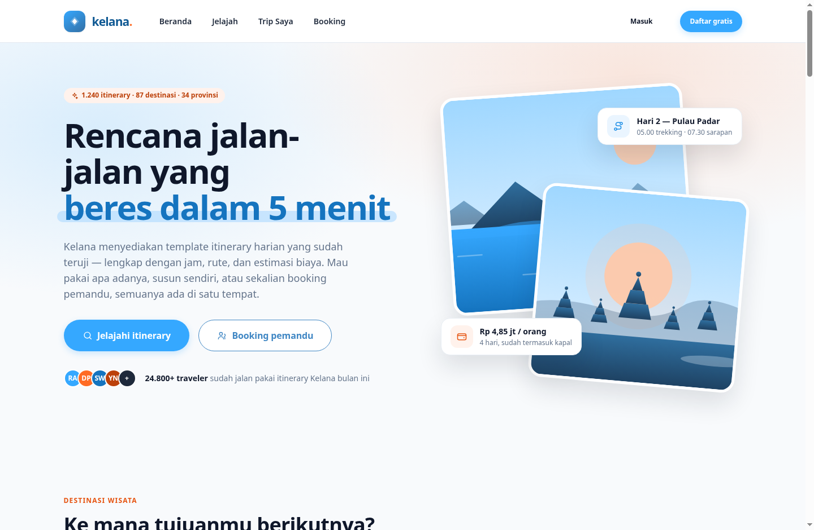
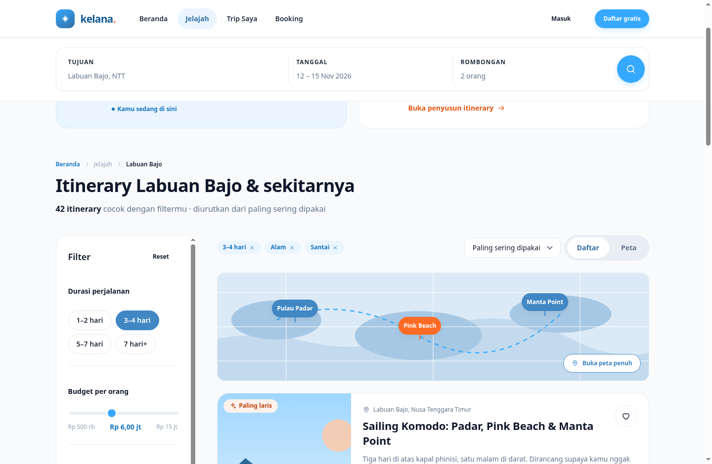
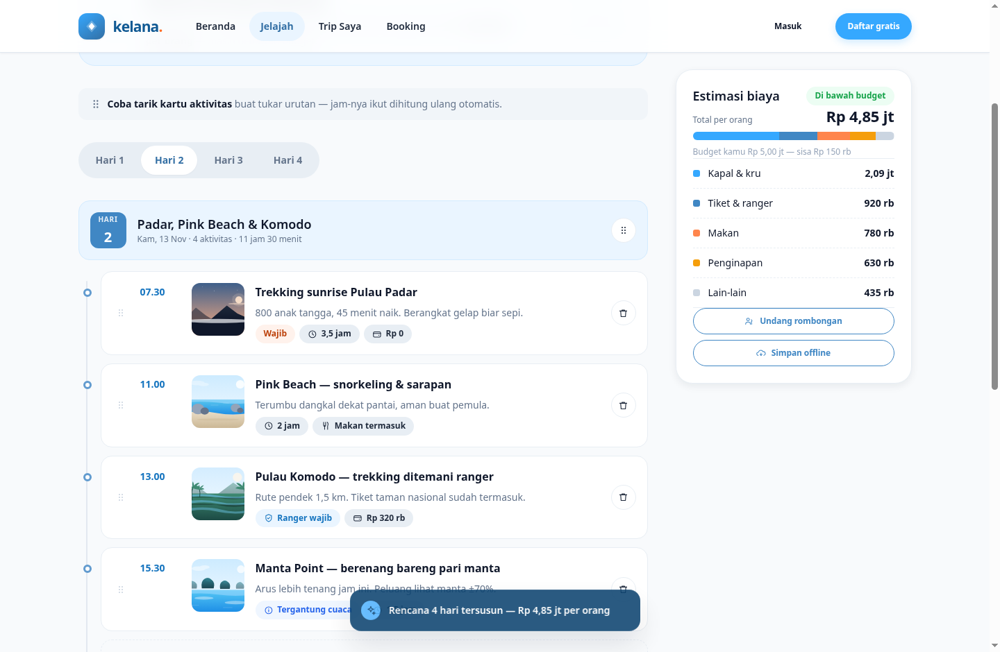
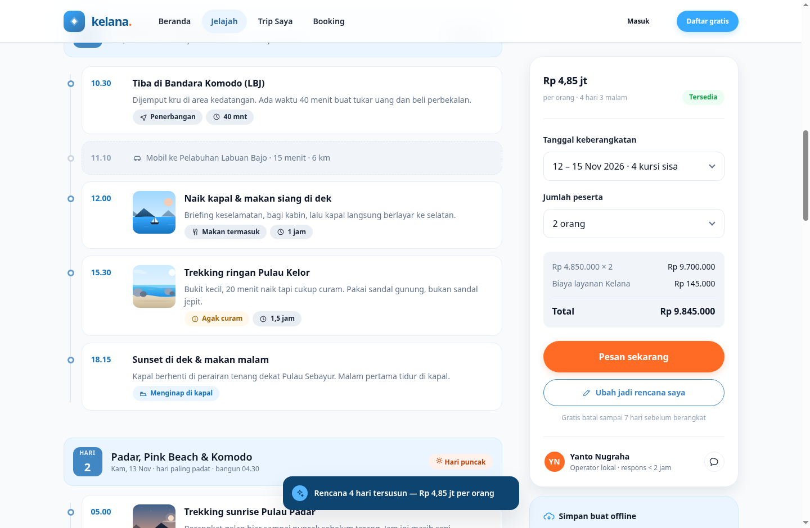
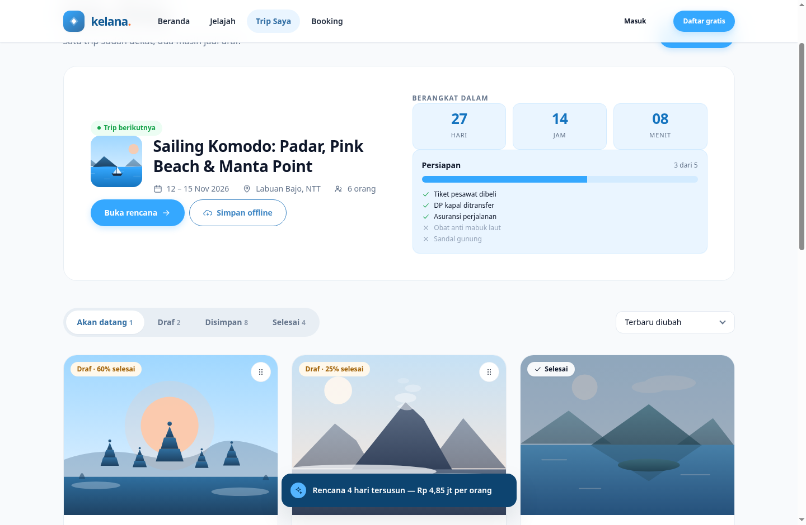
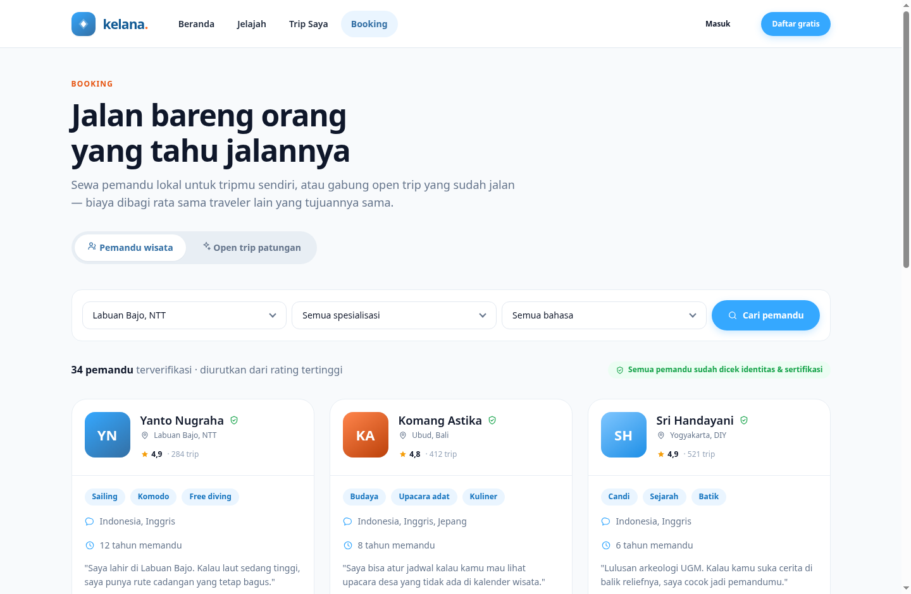
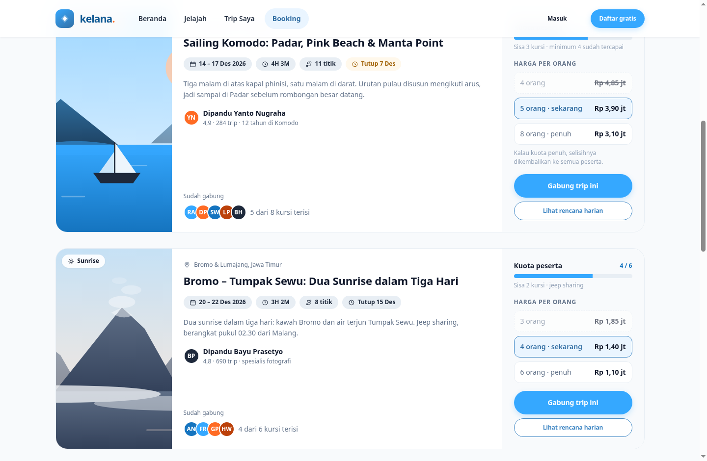
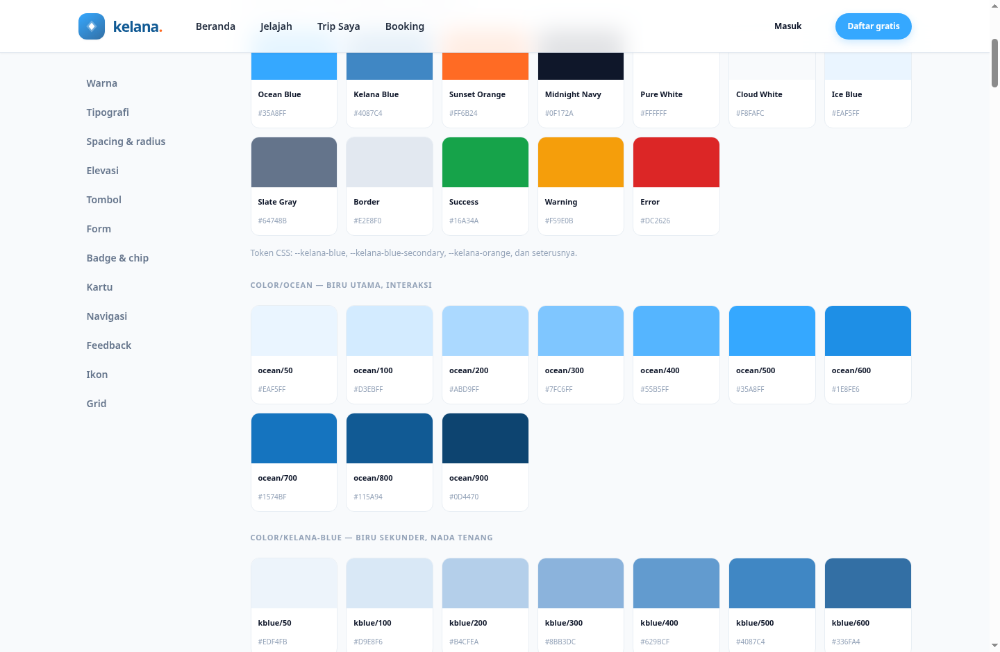
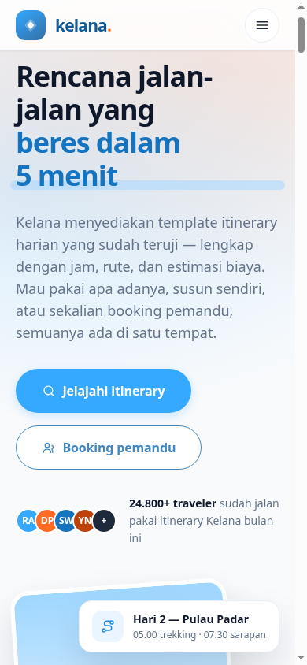

# Kelana — Web App Design v1

Paket desain untuk Kelana, aplikasi penyedia itinerary perjalanan di Indonesia.

Isinya: design system lengkap, prototype interaktif yang bisa diklik, dan file token yang
bisa di-import langsung ke Figma.

---

## Cara pakai

### 1. Lihat prototype-nya (paling cepat)

**Download satu file, lalu klik dua kali. Ada dua bundel sesuai sisi pengguna:**

```
kelana-prototype-LENGKAP.html   — SISI WISATAWAN (8 frame + design system)
kelana-mitra-LENGKAP.html       — SISI MITRA / UMKM / tour guide (3 frame)
```

Masing-masing file mandiri — tanpa server, build step, folder aset, atau koneksi internet.
Bisa dikirim lewat chat/email; penerima cukup klik dua kali, dan punya bar frame sendiri di
pojok kanan bawah untuk pindah antar halaman.

- **`kelana-mitra-LENGKAP.html`** berisi: landing *Jadi Mitra*, wizard pendaftaran,
  dan dashboard pengelolaan. Inilah file yang memuat seluruh UI sisi mitra.
- Bisa dibuka langsung ke frame tertentu pakai hash, mis.
  `kelana-mitra-LENGKAP.html#mitra-dashboard`.

> Dua bundel karena tiap sisi punya navbar/shell sendiri. Generate ulang dengan
> `python3 tools/build-single-file.py` (wisatawan) dan
> `python3 tools/build-mitra-file.py` (mitra) setelah mengubah file di `prototype/`.

### Alternatif: versi multi-halaman

Untuk kerja pengembangan, buka `prototype/index.html`. Strukturnya terpisah per halaman
(CSS, JS, dan 7 file HTML), jadi lebih enak diedit.

Di kanan bawah ada **bar navigasi frame** untuk melompat antar halaman. Yang bisa dicoba:

| Halaman | Yang bisa diklik |
|---|---|
| `index.html` | Pencarian, tab kategori, simpan ♡, modal daftar |
| `explore.html` | Filter chip, checkbox, slider budget, paginasi |
| `itinerary.html` | Tab Jadwal / Biaya / Tips, simpan, bagikan |
| `builder.html` | **Alur 3 langkah + drag-and-drop day planner** ← fitur andalan |
| `trips.html` | Tab status trip, lanjutkan draf |
| `booking.html` | **Pemandu wisata + open trip patungan** · tier harga, modal gabung |
| `checkout.html` | **Konfirmasi trip** — itinerary + pemandu + rincian biaya |
| `mobile.html` | 4 frame mobile dalam device mockup |
| `styleguide.html` | Design system lengkap: warna, tipografi, semua komponen |
| `mitra.html` | **Sisi mitra** — landing "Jadi Mitra Kelana" (UMKM/tour guide) |
| `mitra-login.html` | **Sisi mitra** — login (email/Google) ke dashboard |
| `mitra-daftar.html` | **Sisi mitra** — wizard pendaftaran 4 langkah + status verifikasi |
| `mitra-dashboard.html` | **Sisi mitra** — dashboard: booking masuk, layanan, pendapatan |

Alur ujung-ke-ujung (login mitra, dan susun itinerary → tambah pemandu → checkout)
didokumentasikan di [`docs/03-user-flows.md`](docs/03-user-flows.md).

> **Coba ini saat demo:** buka frame **Builder** → klik sampai langkah 3 → **tarik kartu
> aktivitas** untuk menukar urutan. Jam tiap aktivitas langsung dihitung ulang. Ini bagian
> yang paling susah dijelaskan pakai kata-kata, dan paling meyakinkan kalau dilihat langsung.

### 2. Pindahkan ke Figma

**Cara tercepat — plugin yang membangun sendiri:**

```
figma-plugin/        ← Import lewat Plugins > Development > Import plugin from manifest
```

Plugin ini membuat Variables, Styles, 38 ikon, komponen, dan frame halaman sebagai layer
Figma asli yang bisa kamu edit. Butuh Figma desktop app. Panduan lengkap:
`figma-plugin/README.md`.

**Cara alternatif — hanya token:** file `tokens/kelana.tokens.json` bisa di-import lewat
plugin **Tokens Studio**. 145 token langsung jadi Figma Variables dan Styles, tapi tanpa
komponen dan layout.

**Kalau mau menyusun manual:** `docs/02-figma-build-guide.md` berisi urutan kerja langkah
demi langkah, sekitar 6–9 jam.

### 3. Pahami alasan di balik desainnya

Baca `docs/01-design-brief.md` — masalah yang dipecahkan, persona, alur pengguna, dan lima
keputusan desain yang perlu dibela saat ditanya.

---

## Pratinjau

| Beranda | Jelajah |
|---|---|
|  |  |

| Builder — day planner drag & drop | Detail trip |
|---|---|
|  |  |

| Trip Saya | Booking — pemandu wisata |
|---|---|
|  |  |

| Booking — open trip patungan | Design system |
|---|---|
|  |  |

Responsif di 390px:



---

## Struktur

```
kelana/
├── README.md
├── kelana-prototype-LENGKAP.html .... ★ SATU FILE wisatawan — klik dua kali
├── kelana-mitra-LENGKAP.html ........ ★ SATU FILE mitra/UMKM — klik dua kali
├── docs/
│   ├── 01-design-brief.md ........... masalah, persona, IA, alur, keputusan desain
│   ├── 02-figma-build-guide.md ...... cara membangunnya di Figma, langkah demi langkah
│   └── screenshots/ ................. pratinjau 9 halaman
├── tokens/
│   └── kelana.tokens.json ........... 145 token · format Tokens Studio · siap import
├── figma-plugin/ .................... ★ plugin pembangun file Figma
│   ├── manifest.json ............... import file ini ke Figma
│   ├── code.js ..................... generator: variables, styles, komponen, frame
│   ├── ui.html ..................... panel kontrol + log
│   ├── README.md ................... cara pasang & cakupan
│   └── test/mock-run.js ............ uji logika pakai Figma API palsu
├── tools/
│   ├── build-single-file.py ........ generator bundel wisatawan
│   ├── build-mitra-file.py ......... generator bundel mitra
│   └── audit-palette.py ............ audit proporsi warna dari screenshot
└── prototype/ ...................... versi multi-halaman, untuk dikembangkan
    ├── index.html ................... Beranda
    ├── explore.html ................. Jelajah — cari + pintu masuk builder
    ├── builder.html ................. Builder 3 langkah + drag-drop  (anak Jelajah)
    ├── itinerary.html ............... Detail trip                    (anak Jelajah)
    ├── trips.html ................... Trip Saya
    ├── booking.html ................. Booking — pemandu + open trip patungan
    ├── checkout.html ................ Konfirmasi trip (itinerary + pemandu)
    ├── mitra.html ................... Sisi mitra — landing "Jadi Mitra"
    ├── mitra-login.html ............. Sisi mitra — login
    ├── mitra-daftar.html ............ Sisi mitra — wizard pendaftaran
    ├── mitra-dashboard.html ......... Sisi mitra — dashboard pengelolaan
    ├── mobile.html .................. 4 frame mobile 390×844
    ├── styleguide.html .............. Design system hidup
    └── assets/
        ├── css/tokens.css ........... token — cerminan 1:1 dari kelana.tokens.json
        ├── css/app.css .............. component library
        ├── js/app.js ................ ikon, navigasi, toast, modal, drag-drop
        └── js/scenes.js ............. ilustrasi SVG per destinasi
```

Navigasi utama hanya 4 menu: **Beranda · Jelajah · Trip Saya · Booking**.
Builder dan Detail Trip adalah anak dari Jelajah, bukan menu sendiri.

### Dua sisi (marketplace)

Kelana punya dua sisi pengguna dengan shell navigasi masing-masing:

- **Sisi wisatawan** — 8 halaman di atas, navbar biru + 4 menu.
- **Sisi mitra** (UMKM / tour guide / operator) — `mitra.html`, `mitra-daftar.html`,
  `mitra-dashboard.html`. Navbar sendiri dengan pil "Mitra", dan dashboard memakai
  layout sidebar. Tautan silang: footer wisatawan → "Jadi mitra Kelana", dan sidebar
  mitra → "Ke sisi wisatawan".

Sisi mitra punya bundel satu-file sendiri, **`kelana-mitra-LENGKAP.html`** — karena
tiap sisi butuh navbar/shell berbeda, keduanya tidak digabung dalam satu bundel.
Buka file mitra itu (atau file `prototype/mitra*.html` secara langsung) untuk melihat
seluruh UI sisi mitra.

---

## Identitas brand

**Kelana** — kata Indonesia untuk menjelajah tanpa tujuan tetap. Nada bicaranya
teman yang sudah pernah ke sana: santai, jujur soal hal yang nggak enak, nggak melebih-lebihkan.

| | Nilai | Alasan |
|---|---|---|
| Biru utama | Ocean Blue `#35A8FF` | Langit dan laut Nusantara. Segar, terbuka, mengajak jalan. |
| Biru sekunder | Kelana Blue `#4087C4` | Nada lebih tenang untuk state terpilih, tab, dan pin peta. |
| Aksen | Sunset Orange `#FF6B24` | Senja. Dipakai hemat — maksimal satu aksen per layar. |
| Teks | Midnight Navy `#0F172A` | Kontras 17,4:1 di putih. Tegas tanpa jadi hitam pekat. |
| Latar | Cloud White `#F8FAFC` | Sejuk dan bersih, bukan putih datar. |
| Panel | Ice Blue `#EAF5FF` | Permukaan pendukung untuk komponen biru & state terpilih. |
| Typeface | Plus Jakarta Sans | Dibuat Tokotype di Jakarta. Brand lokal, type lokal. |
| Bentuk khas | Tombol pil (radius penuh) | Penanda visual Kelana yang paling cepat dikenali. |

Dua biru bekerja berpasangan, tidak bersaing: Ocean untuk interaksi yang perlu energi
(tombol primer, fokus, progres), Kelana Blue untuk komponen yang perlu nada tenang
(chip terpilih, tab aktif, pin peta, tombol sekunder).

---

## Catatan teknis

- **Ilustrasi vs foto.** Semua gambar di prototype adalah SVG yang dibuat lewat kode
  (`assets/js/scenes.js`), bukan foto. Tujuannya: prototype jalan tanpa internet, bebas masalah
  lisensi, dan review tetap fokus ke layout serta hierarki. Di Figma, ganti layer bernama
  `Image fill` dengan foto destinasi sungguhan.
- **Font.** Prototype memuat Plus Jakarta Sans dari Google Fonts. Tanpa internet, dia
  fallback ke font sistem — layout tetap benar, hanya bentuk hurufnya berbeda.
- **Ikon.** 38 ikon dibuat khusus untuk Kelana (stroke 1.8px, grid 24px), jadi nggak ada
  ketergantungan lisensi pihak ketiga.
- **Aksesibilitas.** Teks utama Midnight Navy mencapai 17,4:1 di putih; teks sekunder Slate
  4,8:1; tautan biru (Ocean 700) 4,9:1; teks tombol sekunder (Kelana Blue 600) 5,3:1 — semuanya
  lolos WCAG AA. Semua kontrol punya ring fokus 3px Ocean Blue dengan offset 2px, plus label ARIA.

  **Satu pengecualian yang perlu diketahui:** teks putih di atas Ocean Blue `#35A8FF` terukur
  **2,6:1**, di bawah ambang AA 4,5:1 untuk teks 14px bold. Warna ini tetap dipakai pada tombol
  primer karena merupakan ketentuan brand. Kalau kepatuhan WCAG diperlukan, ubah satu baris di
  `tokens.css`:

  ```css
  --btn-primary-bg: var(--ocean-700);   /* #1574BF — terukur 4,9:1 */
  ```

  Tidak ada bagian lain yang perlu disentuh.

---

## Yang di luar lingkup v1

Supaya ekspektasi jelas saat presentasi: alur pembayaran, peta interaktif sungguhan, dasbor
operator itinerary, pengaturan akun, dan mode gelap. Token sudah disusun berlapis
(primitive → semantic), jadi mode gelap nanti cukup menambah satu theme — bukan mendesain ulang.
