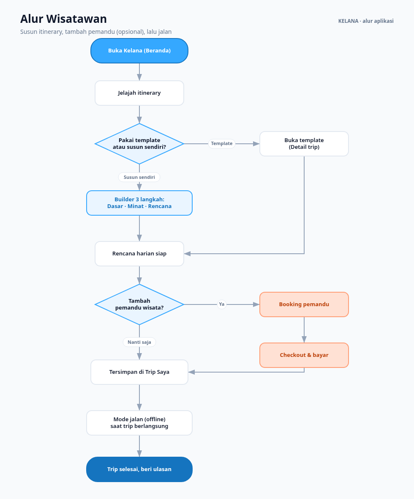
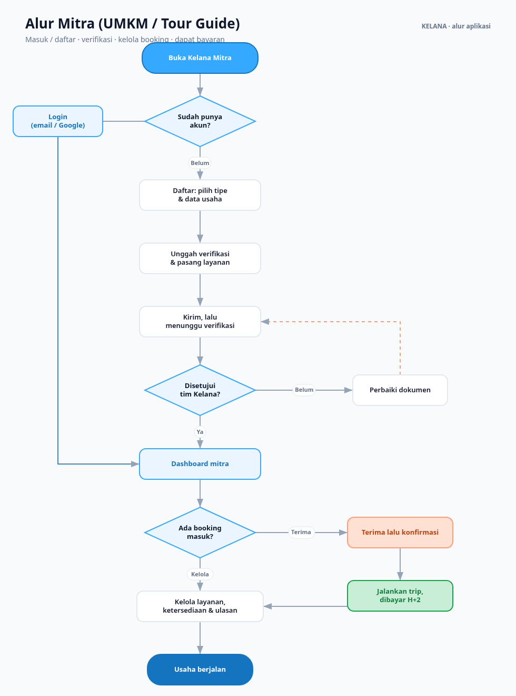
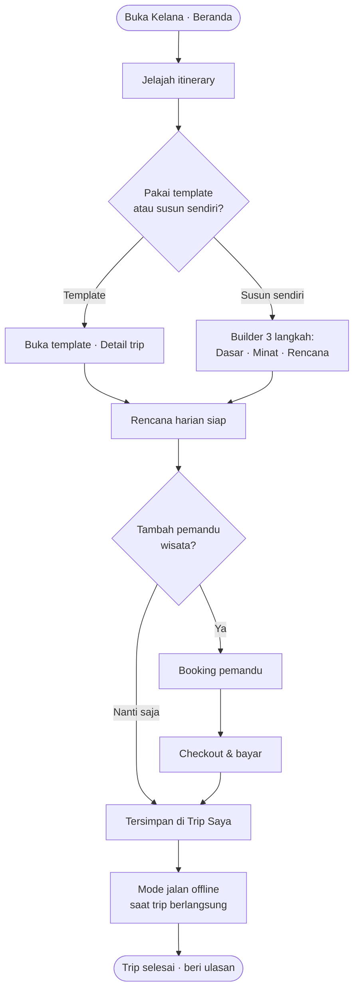
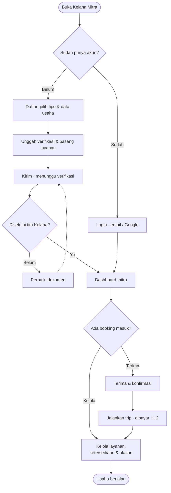

# Alur Pengguna Kelana

Dua sisi marketplace, dengan alur masing-masing. Semua langkah di bawah bisa
diklik di prototype — baik versi multi-halaman (`prototype/*.html`) maupun
bundel satu-file (`kelana-prototype-LENGKAP.html` dan `kelana-mitra-LENGKAP.html`).

---

## Flowchart

Diagram dibuat lewat `tools/build-flowchart.py` (SVG mandiri, tanpa dependensi).
Sumber SVG bisa diedit/diskalakan di `docs/flowcharts/`.

### Alur wisatawan


### Alur mitra


---

## Versi Mermaid (render otomatis di GitHub, paling mudah diedit)

### Wisatawan


### Mitra


---

## A. Mitra (UMKM / tour guide) — mulai dari login

```
mitra.html  (landing "Jadi Mitra")
  │
  ├── "Masuk" ───────────────► mitra-login.html
  │                               │  email + sandi  /  Masuk dengan Google
  │                               │  "Lupa sandi?"  → toast reset
  │                               ▼
  │                            mitra-dashboard.html
  │
  └── "Daftar jadi mitra" ────► mitra-daftar.html
                                  L1 Pilih tipe  (pemandu / UMKM / operator)
                                  L2 Data usaha
                                  L3 Verifikasi dokumen  (dropzone)
                                  L4 Layanan & tarif
                                  ▼  "Selesai & kirim"
                               (status: menunggu verifikasi)
                                  ▼  "Buka dashboard"
                               mitra-dashboard.html
```

**Tautan balik:** `mitra-login.html` → "Belum punya akun? Daftar" → `mitra-daftar.html`.
Dari mana pun di sisi mitra ada "Ke sisi wisatawan" → `index.html`.

### Di dashboard, mitra:
- melihat ringkasan (pendapatan, booking aktif, rating, respons) + grafik;
- menerima/menolak **booking masuk** (badge kuota ikut turun);
- mengelola **layanan aktif** (tayang/draf) & ketersediaan (toggle);
- membalas **ulasan**.

---

## B. Wisatawan — susun itinerary + tambah pemandu

```
index.html  (Beranda)  atau  explore.html  (Jelajah)
  │
  └── "Susun sendiri" ──────► builder.html
                                L1 Dasar   (tujuan, tanggal, rombongan, budget)
                                L2 Minat   (gaya, tempo)
                                L3 Rencana (day planner — tarik untuk urutkan,
                                            jam dihitung ulang)
                                 │  "Selesai & simpan rencana"
                                 ▼
                          ┌─────────────────────────────┐
                          │ MODAL: "mau ditemani pemandu?"│
                          └─────────────────────────────┘
                             │                       │
              "Pilih pemandu"│                       │ "Nanti saja, simpan dulu"
                             ▼                       ▼
                        booking.html            trips.html  (tersimpan)
                        (tab Pemandu)
                             │  modal profil pemandu
                             │  "Tambahkan ke trip"
                             ▼
                        checkout.html
                          ringkasan: itinerary + pemandu (bisa "Hapus")
                          rincian biaya → total terupdate otomatis
                             │  "Konfirmasi & bayar"
                             ▼
                        trips.html  (trip + pemandu tersimpan)
```

**Jalur alternatif:** wisatawan bisa langsung buka `booking.html` (tanpa builder)
untuk sewa pemandu atau gabung **open trip patungan** — keduanya bermuara ke
`checkout.html`.

### Prinsip desain alur
- **Tambah pemandu itu opsional, bukan paksaan.** Modal pasca-susun menawarkan,
  tidak memblokir — "Nanti saja" selalu ada.
- **Biaya transparan sebelum bayar.** Checkout memecah itinerary + pemandu +
  biaya layanan; menghapus pemandu langsung mengurangi total.
- **Pembayaran ditahan sampai trip selesai** (ditulis eksplisit di checkout),
  menautkan kembali ke janji "bayaran tepat waktu" di sisi mitra.

---

## Peta file ↔ layar

| Layar | File | Sisi |
|---|---|---|
| Beranda | `index.html` | wisatawan |
| Jelajah | `explore.html` | wisatawan |
| Builder itinerary | `builder.html` | wisatawan |
| Detail trip | `itinerary.html` | wisatawan |
| Booking pemandu / open trip | `booking.html` | wisatawan |
| **Checkout / konfirmasi** | `checkout.html` | wisatawan |
| Trip saya | `trips.html` | wisatawan |
| Landing mitra | `mitra.html` | mitra |
| **Login mitra** | `mitra-login.html` | mitra |
| Daftar mitra | `mitra-daftar.html` | mitra |
| Dashboard mitra | `mitra-dashboard.html` | mitra |
